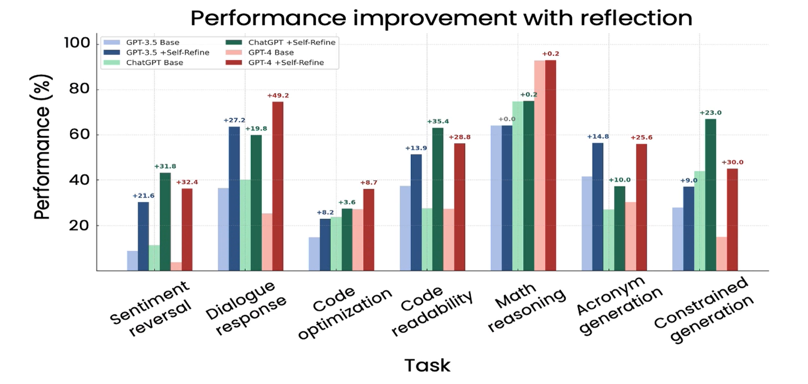

# What is the the Reflection Design Pattern
The Reflection design pattern is a method of prompting LLM systems that allows them to seperate their thought into stages much like a person would. 

## How does it work
If we asked a person to write an essay about a given topic they could produce an essay. While it does technically complete the task often times, first drafts have errors or other kinds of flaws, perhaps don't flow the way that the auther would have liked or upon second reading an unintended interpretation becomes obvious.

In humans we resolve this proble by doing a second pass as a critic of our own work. It helps us to spot flaws and areas that could use improvement. 

Finally once the critic pass is done we once again write the paper rewording and correcting falts that were found in our second pass

The aim of the Reflection design pattern is to mimic this behavour using LLM systems. In this example we will recreate the process discussed above.

1. Write
2. Reflect
3. Rewrite

## Why should we use this pattern?

The Reflection pattern provides several meaningful benifits. Firstly is the notable improvement on an LLMs ability to complete a given task. Benchmarking has shown that in many cases a small or early gen model using reflection has the potential to outperform larger and more advanced models that only use a single prompt.



Not only are these preformance improvments desirable from a task completion quality standpoint. they can also allow use of simpler and less expensive models for use in tasks that would otherwise require more advanced models.

## How you can try it yourself
Step 1: Clone the repo to your computer. Make sure you have Python 3.13 or higher installed.
Step 2: Create a virtual environment in the cloned folder with ```Python -m .venv venv```
Step 3: Start the venv by running ```.\.venv\Scripts\Activate.ps1```
Step 4: Install the requirements by running ```pip install requirements.txt```
Step 5: Create a file in the root of your folder called .env and put the following line inside.
 ```OPENAI_API_KEY = "Whatever your API key is"
Step 6: Run it and collect your essay. 